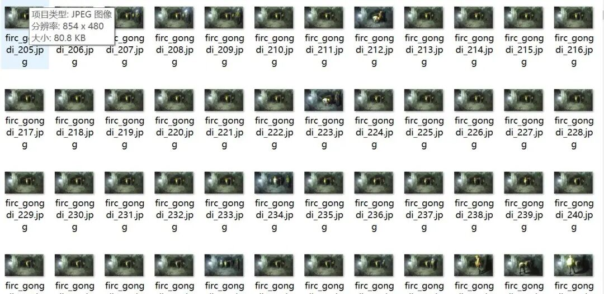
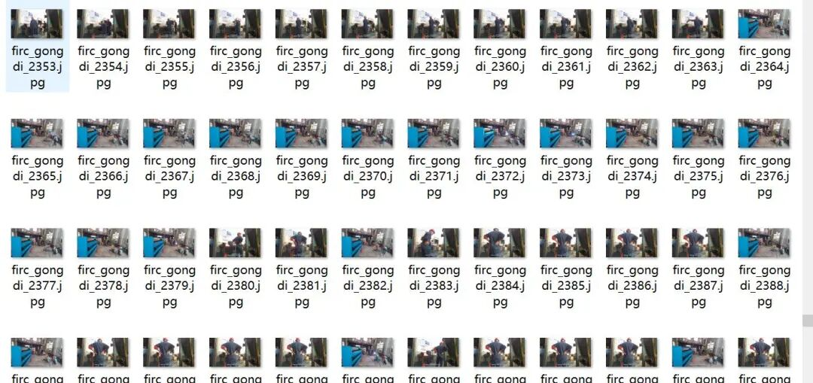
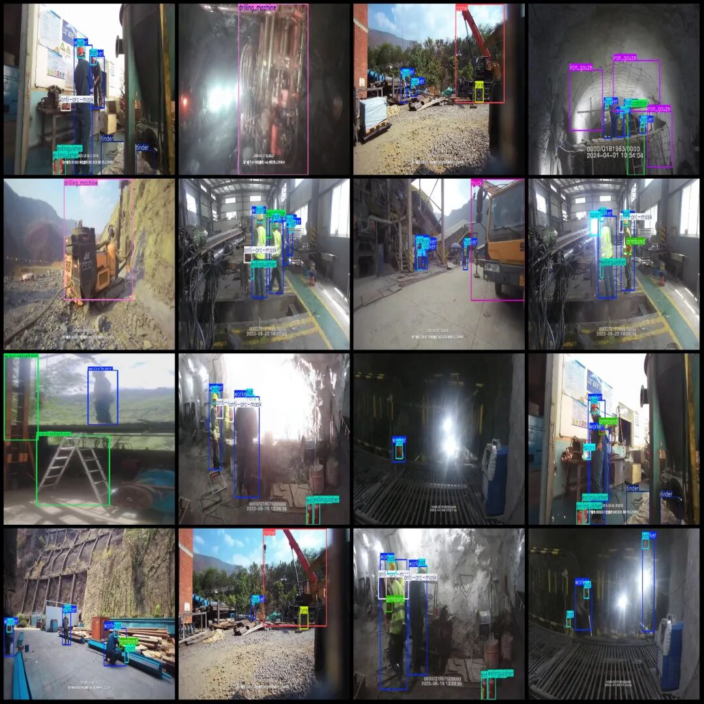
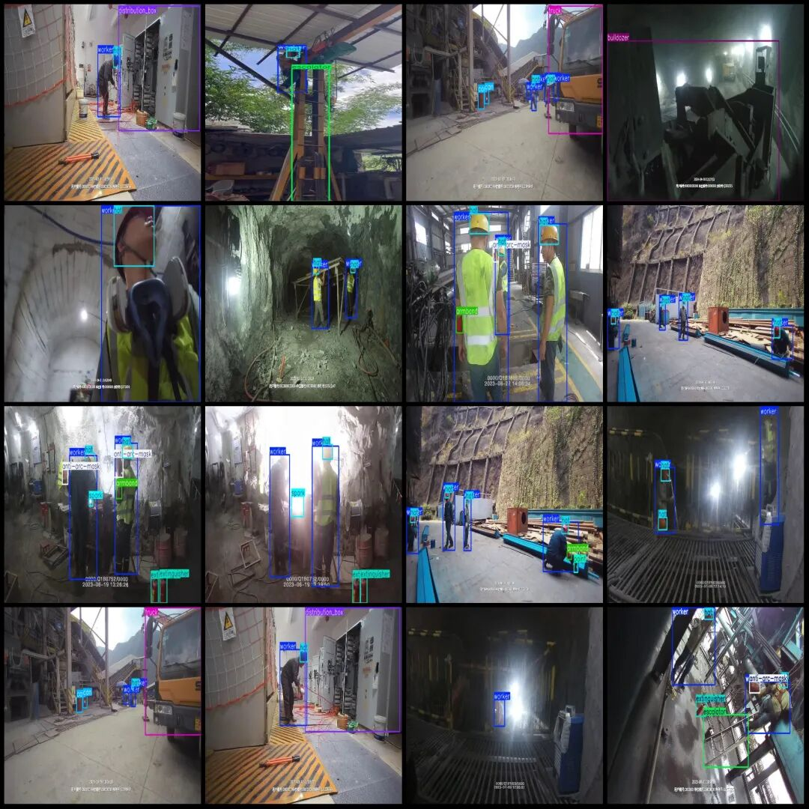

# Smart Construction Site - Dataset of various equipment, vehicles, paint, tires, safety helmets, sparks, and flammable substances in construction sites in VOC+YOLO format with 3012 images across 19 categories

Dataset format: Pascal VOC format + YOLO format (txt file without split path, only containing jpg images and corresponding VOC format xml files and yolo format txt files)

Number of images (number of jpg files): 3012

Number of annotations (number of xml files): 3012

Number of annotations (number of txt files): 3012

Labeling category count: 19

Label category names (Note that the order of labels in the YOLO format does not correspond to this, but is based on the classes.txt file in the labels folder): ["anti-arc-mask", "armband", "bulldozer", "can", "crane", "discharge_table", "distribution_box", "drilling_machine", "escalator", "extinguisher", "hat", "iron_gauze", "loader", "paint", "spark", "tinder", "truck", "tyre", "worker"]

Number of boxes labeled in each category:

Anti-arc mask (anti-arc mask) frame count = 567

Armband (Sleeve) Frame Count = 552

Bulldozer (Backhoe) Frame Count = 237

Can (can body) frame count = 447

Crane (crane) Frame Count = 131

Discharge table (discharge plate) frame count = 234

Distribution box (Distribution box) Frame count = 162

Drilling machine (drilling machine) Frame count = 223

Escalator (automatic escalator) frame count = 681

Extinguisher (Fire Extinguisher) Frame Count = 1289

Hat (hat/Safety Cap) Frame Count = 4905

Iron gauze (iron net) frame count = 417

Loader (Loader) Frame Count = 23

Paint (paint) Frames = 70

Spark (Spark) Frame Count = 208

Tinder (flammable) frame count = 483

Truck (truck) Frame Count = 576

Tyre (tire) Frame Count = 306

Worker (Worker) Frames = 5575

Total frame count: 17086

Image resolution: 854x480

Using labelImg:

Annotation rules: Draw a rectangle around the category.

Important Notice: No

Special : This dataset does not guarantee the accuracy of the trained models or weight files.

Image Preview:

Annotation example:

## Payment

Here is a pay link on Stripe ( https://buy.stripe.com/3cs8yP7sY87d0vu9AB ). Please contact me lonlonago@foxmail.com after funding $89, and I will send you a complete data files , thank you!

